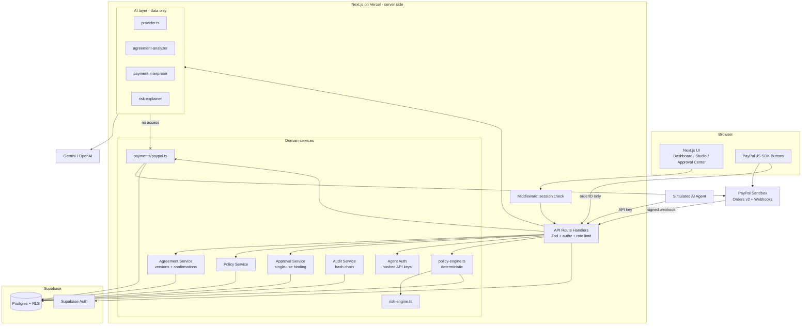
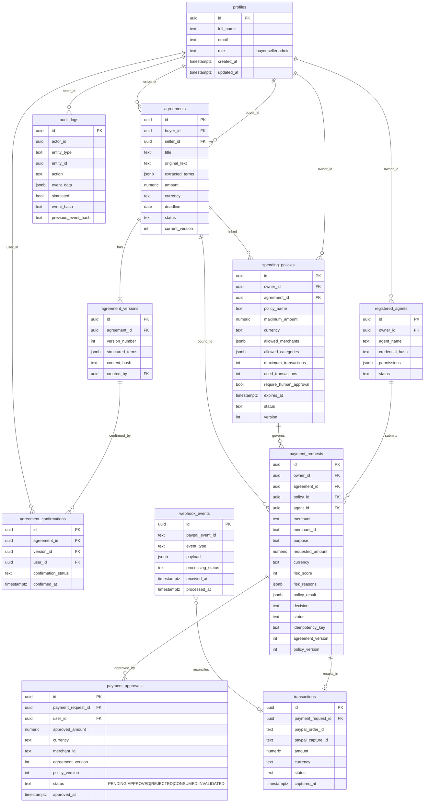
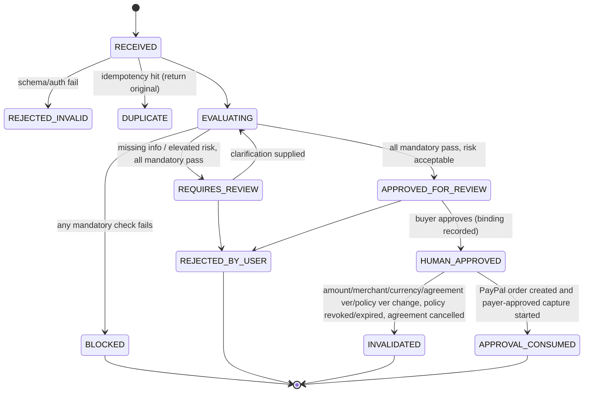
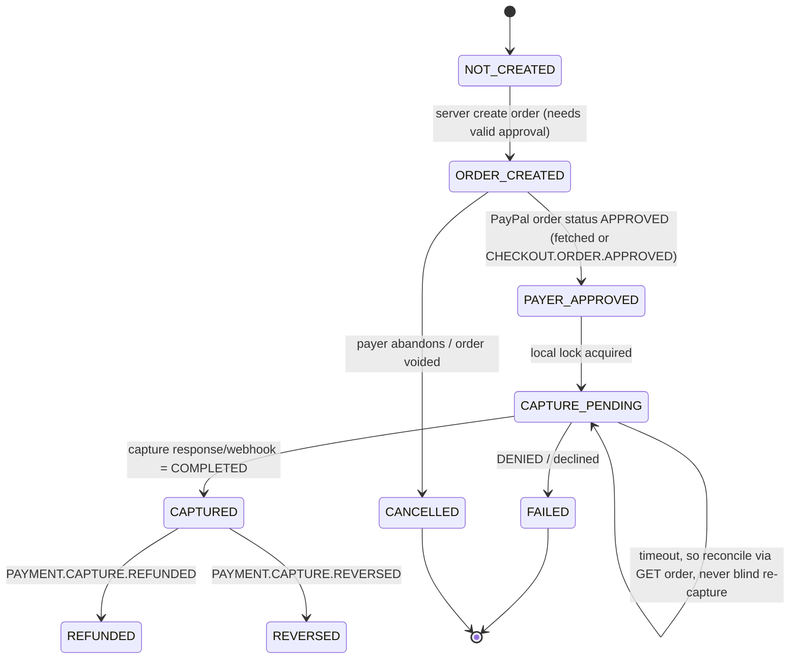

# PAYSHARK AI — Phase 0 Architecture

Tagline: Trust Every Agreement. Control Every Payment.
Principle: **AI interprets. Rules enforce. Humans authorize. PayPal processes.**

Scope note: PayPal Sandbox only. No escrow, no fraud-prevention guarantee, no legal enforceability claims.

---

## 1. Final technical architecture

| Layer | Choice | Reason |
|---|---|---|
| Framework | Next.js 15 (App Router), TypeScript strict | One deployable for UI + API routes |
| Hosting | Vercel | Native Next.js, easy env management |
| Database / Auth | Supabase (Postgres, Auth, RLS) | Auth + RLS + SQL migrations in one |
| AI | Gemini API **or** OpenAI (one, chosen via `AI_PROVIDER`) | Structured JSON output; one provider for MVP |
| Payments | PayPal Orders API v2 (REST, server-side) + `@paypal/react-paypal-js` | Official SDK for buttons, REST for create/capture |
| Validation | Zod | Shared request and AI-output schemas |
| Money | `decimal.js` | No floating point in authorization |
| UI | Tailwind CSS + shadcn/ui | Fast, accessible components |
| Tests | Vitest (unit/integration), Playwright (e2e) | As specified |

### Trust boundaries (non-negotiable)

1. Browser → never holds service-role key, PayPal secret, AI key.
2. AI module → returns *data only*. It has no import path to `payments/` or to DB write helpers for approvals/decisions.
3. `policy-engine.ts` is pure and deterministic (input: loaded records + request; output: decision). It does not call AI.
4. `payments/paypal.ts` re-validates authorization itself (approval row exists, single-use, amount/currency/merchant/versions match) before create/capture.
5. Capture status is set only from PayPal's capture response (or verified webhook).
6. Service-role DB client is used only in server code (`lib/database/admin.ts`, marked `server-only`).

### Request pipeline for an agent payment request

```
Agent (API key) → authenticate → Zod validate → idempotency check
 → load agreement + policy (ownership-scoped)
 → verify confirmations of current version
 → policy-engine (13 checks, decimal math)         ← decides
 → risk-engine (score, evidence-based reasons)      ← informs, never overrides BLOCKED
 → risk-explainer (AI, text only)                   ← explains
 → persist decision + audit event (atomic, counter reserved atomically)
 → if APPROVED_FOR_REVIEW: wait for human approval
 → human approval (bound to amount/currency/merchant/agreement ver/policy ver, single use)
 → create PayPal order (server) → payer approves in PayPal
 → server fetches order, re-checks binding → capture (server) → verify capture → persist
 → webhook confirms/reconciles
```

---

## 2. System architecture diagram (Mermaid)



---

## 3. Database ER diagram



### Key constraints (to implement in migrations)

- `CHECK (amount > 0)`, `CHECK (maximum_amount > 0)`, `CHECK (used_transactions <= maximum_transactions)`, currency `CHECK (currency ~ '^[A-Z]{3}$')`.
- `UNIQUE (agreement_id, version_number)`, `UNIQUE (version_id, user_id)` on confirmations.
- `UNIQUE (agent_id, idempotency_key)` on payment_requests.
- `UNIQUE (paypal_order_id)`, `UNIQUE (paypal_capture_id)`, `UNIQUE (payment_request_id)` on transactions (one capture per request).
- `UNIQUE (paypal_event_id)` on webhook_events (replay protection).
- Partial unique index: one `APPROVED` (unconsumed) approval per payment_request.
- Additions beyond your list (justified): `payment_requests.agreement_version`, `policy_version` (needed for binding checks); `audit_logs.simulated` (to separate demo events); `payment_approvals` status values.
- Atomic limit reservation: SQL function `reserve_policy_use(policy_id)` doing `UPDATE ... SET used_transactions = used_transactions + 1 WHERE id = $1 AND status='ACTIVE' AND used_transactions < maximum_transactions AND expires_at > now() RETURNING *`. Zero rows → `LIMIT_EXHAUSTED`/inactive.
- `audit_logs`: RLS allows INSERT via server only and SELECT by owner; `REVOKE UPDATE, DELETE`; trigger raising an exception on update/delete.
- Hash chain: `event_hash = sha256(previous_event_hash || canonical_json(event))`, chained per `entity_id`, inserted inside a transaction with a row lock on the chain head.

---

## 4. Folder structure

```
payshark-ai/
├─ public/
├─ src/
│  ├─ app/
│  │  ├─ (marketing)/page.tsx            # landing
│  │  ├─ (auth)/login, register, reset/
│  │  ├─ dashboard/                      # overview
│  │  ├─ agreements/ [id]/ new/
│  │  ├─ policies/ [id]/ new/
│  │  ├─ payment-requests/ [id]/
│  │  ├─ approvals/ [id]/
│  │  ├─ transactions/ [id]/
│  │  ├─ audit/
│  │  ├─ settings/
│  │  ├─ demo/                           # attack simulator
│  │  └─ api/ (routes in section 5)
│  ├─ components/ layout, dashboard, agreements, policies, security, payments, shared
│  ├─ lib/
│  │  ├─ ai/ provider.ts agreement-analyzer.ts payment-interpreter.ts risk-explainer.ts schemas.ts
│  │  ├─ auth/ session.ts roles.ts agent-auth.ts
│  │  ├─ database/ client.ts admin.ts(server-only) repositories/
│  │  ├─ payments/ paypal.ts payment-state.ts webhook.ts
│  │  ├─ security/ policy-engine.ts risk-engine.ts approval.ts rate-limit.ts money.ts
│  │  ├─ audit/ audit.ts hash-chain.ts
│  │  ├─ validation/ env.ts schemas.ts api-error.ts
│  │  └─ agreements/ versioning.ts confirmation.ts
│  ├─ types/  hooks/  middleware.ts
├─ supabase/ migrations/ seed.sql
├─ scripts/ seed-demo.ts  agent-simulator.ts
├─ tests/ unit/ integration/ e2e/
├─ docs/ architecture.md api.md security.md demo.md
├─ .env.example  .gitignore  LICENSE (MIT)  README.md  package.json
```

---

## 5. API contracts

Common rules for every route: authenticate (session cookie, or `Authorization: Bearer <agent key>` for agent routes) → Zod validate → ownership/role check → rate limit → structured response → audit security-sensitive actions.

Response envelope:
```json
{ "ok": true, "data": { } }
{ "ok": false, "error": { "code": "AMOUNT_EXCEEDED", "message": "...", "details": [] } }
```
Error codes: `UNAUTHENTICATED 401`, `FORBIDDEN 403`, `NOT_FOUND 404` (also used for other users' records), `VALIDATION_FAILED 422`, `CONFLICT 409`, `RATE_LIMITED 429`, `AI_UNAVAILABLE 503`, `PAYPAL_ERROR 502`, `INTERNAL 500`.

### Auth & profiles
| Route | Auth | Body → Response |
|---|---|---|
| POST /api/profile/setup | user | `{full_name, role: "buyer"\|"seller"}` (admin rejected) → profile |
| GET /api/profile | user | → profile |
| PATCH /api/profile | user | `{full_name?}` (role not editable) → profile |

### Agreements
| Route | Who | Contract |
|---|---|---|
| POST /api/agreements | buyer/seller | `{title, original_text, counterparty_email}` → agreement (DRAFT) |
| GET /api/agreements | party | list own (RLS) |
| GET /api/agreements/[id] | party | agreement + versions + confirmations |
| POST /api/agreements/[id]/analyze | party | runs AI → validated terms, `missing_information`, `conflicting_information`, `clarification_questions`, completeness %; status → NEEDS_CLARIFICATION or PENDING_CONFIRMATION; creates version if none |
| POST /api/agreements/[id]/clarify | party | `{answers: [{question, answer}]}` → new version (re-analysis); invalidates confirmations |
| POST /api/agreements/[id]/confirm | party | `{version_number, action: "confirm"\|"reject"}`; version must equal current; when both confirmed → ACTIVE |
| POST /api/agreements/[id]/versions | party | `{structured_terms}` edit → new version, old → SUPERSEDED confirmations void, linked policies re-evaluated |
| POST /api/agreements/[id]/cancel | party | → CANCELLED; linked policies revoked |

### Policies
| Route | Who | Contract |
|---|---|---|
| POST /api/policies | buyer | `{policy_name, agreement_id, maximum_amount (string decimal), currency, allowed_merchants[], allowed_categories[], maximum_transactions, expires_at, require_human_approval}` → ACTIVE only if agreement ACTIVE, else DRAFT |
| GET /api/policies, GET /api/policies/[id] | owner | |
| PATCH /api/policies/[id] | owner | any material change bumps `version`; approvals tied to old version INVALIDATED |
| POST /api/policies/[id]/revoke | owner | → REVOKED; pending approvals invalidated |

### Agents
| Route | Contract |
|---|---|
| POST /api/agents/register | `{agent_name, permissions}` → `{id, api_key}` (shown once, only hash stored) |
| GET /api/agents | list (no credentials) |
| POST /api/agents/[id]/revoke | → REVOKED |

### Payment requests
| Route | Who | Contract |
|---|---|---|
| POST /api/payment-requests | agent key (or buyer session for demo) | `{policy_id, agreement_id, merchant, merchant_id, purpose, amount, currency, idempotency_key, instruction_text?}`. Owner derived from agent, never from body. Same idempotency key → returns original result. → `{id, decision, reason_codes, checks, risk_score}` |
| GET /api/payment-requests, /[id] | owner / seller (read) | |
| POST …/[id]/evaluate | owner | re-run engine (e.g. after clarification); never upgrades a BLOCKED request created under an inactive policy |
| POST …/[id]/approve | buyer only | `{confirm: true}`; creates single-use approval bound to exact values; only if decision = APPROVED_FOR_REVIEW |
| POST …/[id]/reject | buyer | |
| POST …/[id]/clarify | buyer | `{question}` → status NEEDS_CLARIFICATION |

### PayPal
| Route | Contract |
|---|---|
| POST /api/payments/paypal/create-order | `{payment_request_id}`. Requires valid unconsumed approval + policy engine re-run. Server builds amount/currency from DB (client sends no amount). Uses `PayPal-Request-Id` = payment_request_id. → `{paypal_order_id}` |
| POST /api/payments/paypal/capture-order | `{paypal_order_id}`. Server: lookup local tx by order id → GET order from PayPal → verify status `APPROVED`, amount, currency, `custom_id` = payment_request_id → atomically mark approval CONSUMED + status CAPTURE_PENDING → capture → verify `COMPLETED` → CAPTURED |
| GET /api/payments/[id] | owner/seller | transaction + timeline |
| POST /api/webhooks/paypal | PayPal | verify via `/v1/notifications/verify-webhook-signature`; dedupe on `paypal_event_id`; no session auth |

### Audit
GET /api/audit (own events, paginated), GET /api/audit/[entityId] (timeline + chain verification result).

Extra (demo only, disabled in production unless `DEMO_MODE=true`): POST /api/demo/reset, POST /api/demo/scenario/[A-E].

---

## 6. Authorization state machine


BLOCKED is terminal; a new request is needed. Risk score can raise APPROVED_FOR_REVIEW to REQUIRES_REVIEW, never lower BLOCKED.

Policy engine checks (all return pass/fail, stable reason codes): `POLICY_NOT_FOUND`, `POLICY_INACTIVE`, `POLICY_EXPIRED`, `NOT_AUTHORIZED_FOR_POLICY`, `AGREEMENT_NOT_ACTIVE`, `AGREEMENT_NOT_CONFIRMED`, `AMOUNT_EXCEEDED`, `CURRENCY_MISMATCH`, `MERCHANT_NOT_ALLOWED`, `PURPOSE_NOT_ALLOWED`, `LIMIT_EXHAUSTED`, `DUPLICATE_REQUEST`, `AGREEMENT_VERSION_MISMATCH`.

MVP decision on purpose mismatch (scenario D): **REQUIRES_REVIEW** by default (purpose is matched against allowed categories + agreement `transaction_purpose` by normalized keyword match, deterministically; the AI only explains).

## 7. PayPal payment state machine


Webhook handling: unique `paypal_event_id`; transitions are monotonic (an out-of-order event never moves status backward; `CAPTURED` cannot return to `ORDER_CREATED`); unknown transitions are logged and stored as `IGNORED`.

---

## 8. Security threat model

| # | Threat | Detection | Prevention | Logging | Failure response |
|---|---|---|---|---|---|
| 1 | Agent changes amount after approval | approval binding mismatch | approval stores exact amount/currency/merchant/versions; create-order reads from DB, ignores client values | `APPROVAL_BINDING_MISMATCH` | 409, approval INVALIDATED |
| 2 | Merchant changed after approval | merchant_id compare | same binding | same | 409 |
| 3 | Repeated requests | idempotency key + frequency rule in risk engine | unique(agent_id, idempotency_key), rate limit | `DUPLICATE_REQUEST`, `RATE_LIMITED` | return original result / 429 |
| 4 | Expired policy | `expires_at <= now()` in engine and in atomic reserve | policy check at request AND at create-order | `POLICY_EXPIRED` | BLOCKED, no PayPal call |
| 5 | Other user's policy ID | owner/agent-owner mismatch | RLS + server ownership check; agent key scoped to owner | `CROSS_TENANT_ACCESS_ATTEMPT` | 404 |
| 6 | Bypass frontend | n/a | all checks server-side, RLS, role checks in handlers | `FORBIDDEN` events | 403 |
| 7 | Prompt injection in document | injection-pattern flags (advisory) | untrusted text delimited as data, AI output schema-validated, AI has no tools/side effects, amount/currency re-validated deterministically, user confirms terms | `AI_OUTPUT_REJECTED` | 422, ask user to review |
| 8 | Fake PayPal success from client | n/a | client sends only order id; server GETs order and captures itself | `PAYPAL_VERIFY_FAILED` | 400 |
| 9 | Webhook replay | unique `paypal_event_id` | signature verify + dedupe + monotonic state | `WEBHOOK_DUPLICATE` | 200 no-op |
| 10 | Concurrent consumption of allowance | `reserve_policy_use` returns 0 rows | single atomic UPDATE with WHERE guards; unique partial indexes | `LIMIT_EXHAUSTED` | BLOCKED |
| 11 | Read other user's audit | n/a | RLS on audit_logs | `FORBIDDEN` | 404 |
| 12 | PayPal timeout during capture | request error/timeout | state `CAPTURE_PENDING`; reconcile by GET order/capture; same `PayPal-Request-Id` on retry; never second blind capture | `CAPTURE_TIMEOUT_RECONCILING` | 202 "verifying", poll |

Additional: secrets validated at startup (`env.ts`), service role key `server-only`, agent API keys stored as SHA-256 of high-entropy token (shown once), CSP + secure headers, no card data stored, PayPal access token cached in memory only, error responses never leak internals, uploaded-file handling deferred (post-MVP; TXT first).

Residual risks / honest limitations: sandbox only; no real KYC; rate limiting in MVP is in-memory/DB-based (not distributed); completeness % is not legal validity; risk score thresholds (30/60) are configuration, not validated probabilities; human approval ≠ PayPal payer approval and both are shown separately.

---

## 9. Exact initial dependency list

Runtime:
`next@15`, `react@19`, `react-dom@19`, `typescript`, `@supabase/supabase-js`, `@supabase/ssr`, `zod`, `decimal.js`, `@paypal/react-paypal-js`, `server-only`, `lucide-react`, `clsx`, `tailwind-merge`, `class-variance-authority`, `recharts` (overview chart only), AI SDK: **either** `@google/genai` **or** `openai` (pick one; recommended: whichever key you already have).

Dev:
`tailwindcss`, `postcss`, `autoprefixer`, `eslint`, `eslint-config-next`, `vitest`, `@vitest/coverage-v8`, `@playwright/test`, `tsx`, `supabase` (CLI), `@types/node`, `@types/react`.

Deferred: `pdf-parse` (PDF upload), Upstash rate limiting (post-MVP).

Credentials needed by Phase: Supabase project (Phase 2), Gemini or OpenAI key (Phase 3), PayPal Sandbox REST app client id/secret + two sandbox accounts (business + personal) (Phase 6), PayPal webhook ID after deploying (Phase 6/10).

---

## 10. Solo-developer priority list

Must-have (demo-critical), in order:
1. Scaffold + Supabase auth + profiles + RLS (Phases 1–2).
2. Agreement create → AI extract (text input only) → version → mutual confirm (Phase 3).
3. Policy create/revoke + **policy-engine with unit tests** (Phases 4–5).
4. Agent registration + payment request API + approval binding (Phase 5).
5. PayPal create/capture with server verification (Phase 6) → **real sandbox capture**.
6. Audit timeline with hash chain (Phase 7).
7. Demo page: attack simulator (A–E) driven by seed + scenario endpoints.

Should-have: webhook verification and reconciliation, risk engine score, risk explainer, dashboard from real queries, loading/empty/error states.

Cut or defer (listed as limitations): PDF/DOCX upload, analytics charts, distributed rate limiting, seller fulfilment evidence, admin console beyond basic metrics, multi-currency beyond USD in UI.

Suggested cut line if time slips: keep items 1–6 plus scenarios A and B; everything else is polish.

### Decisions I need from you before Phase 1
1. AI provider: Gemini or OpenAI?
2. Confirm the name is **PAYSHARK AI** everywhere (tagline kept as "Trust Every Agreement. Control Every Payment.")?
3. Seller onboarding: counterparty identified by email at agreement creation (my default)?
4. Purpose-mismatch default: REQUIRES_REVIEW (my default) or BLOCKED?
